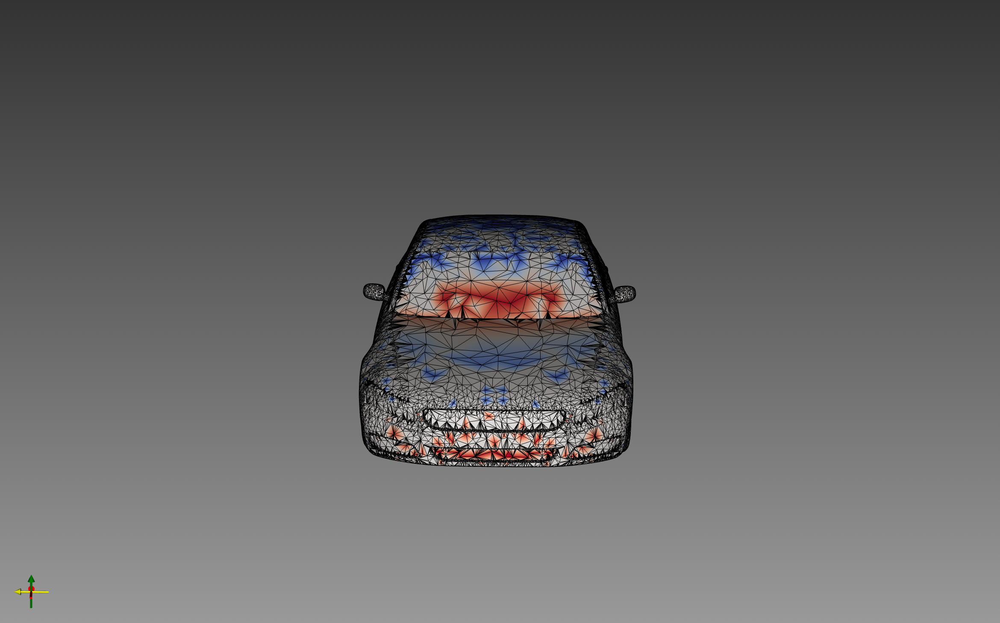
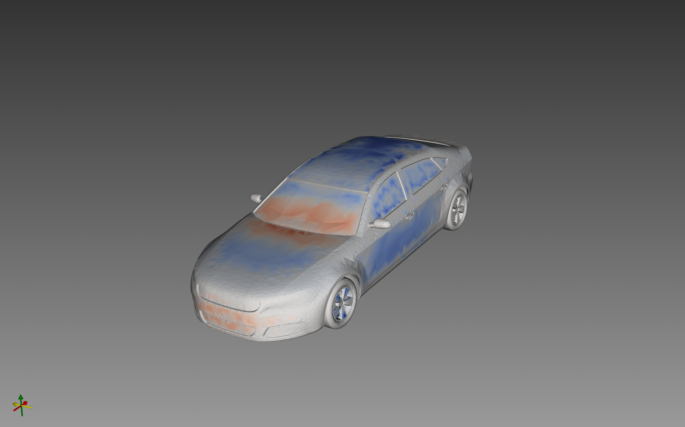
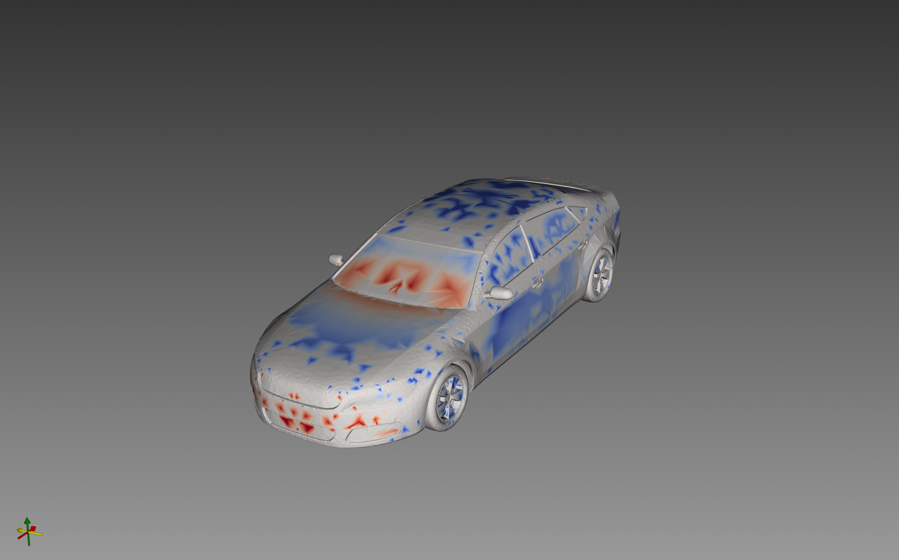
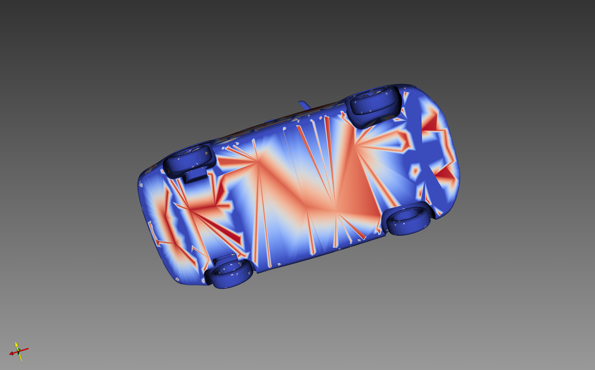
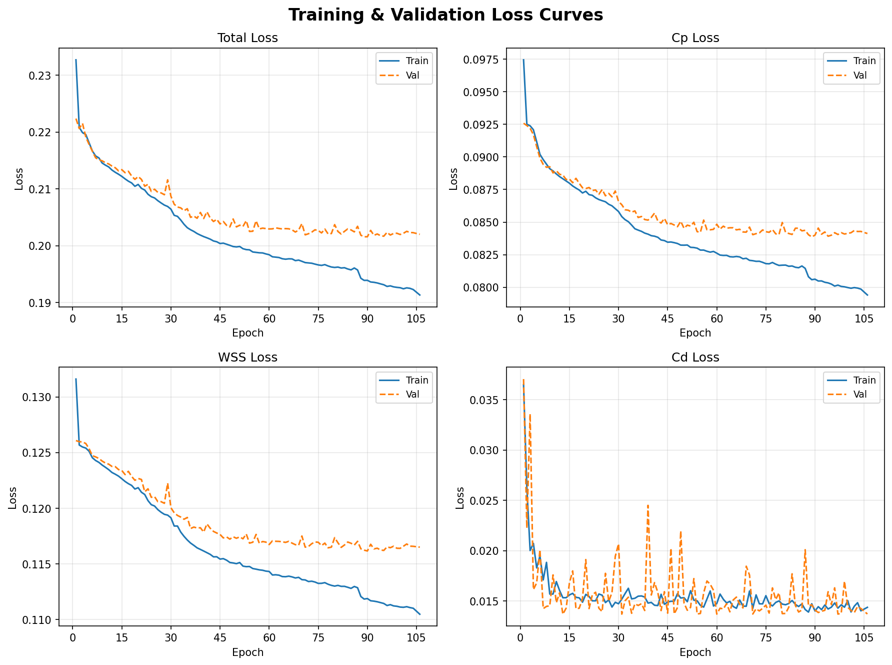

<div align="center">

<br/>

```
███████╗ ██╗   █████╗ ███████╗██████╗  ██████╗ ███╗  ██╗███████╗████████╗
██╔════╝███║  ██╔══██╗██╔════╝██╔══██╗██╔═══██╗████╗ ██║██╔════╝╚══██╔══╝
█████╗  ╚██║  ███████║█████╗  ██████╔╝██║   ██║██╔██╗██║█████╗     ██║   
██╔══╝   ██║  ██╔══██║██╔══╝  ██╔══██╗██║   ██║██║╚████║██╔══╝     ██║   
 ██║      ██║  ██║  ██║███████╗██║  ██║╚██████╔╝██║ ╚███║███████╗   ██║    
```

### **Gauge Equivariant Mesh CNNs for Aerodynamic Field Prediction**
*An early research experiment: learning surface pressure and wall shear stress on 3D car meshes from DrivAerNet++*

<br/>

[](https://python.org)
[](https://pytorch.org)
[](https://pyg.org)
[](LICENSE)
[](#-licence-and-data)

<br/>



<br/>

</div>

---

## ⚡ What is this?

**F1AeroNet** is a from-scratch PyTorch implementation of **Gauge Equivariant Mesh CNNs** ([de Haan et al., 2020](https://arxiv.org/abs/2003.05425)) applied to automotive aerodynamics. Given a car surface mesh, it predicts per-vertex pressure coefficient (Cp), per-vertex wall shear stress (WSS) and a global drag coefficient (Cd).

It is a **research experiment, not a CFD replacement**. It was trained on 210 car designs from [DrivAerNet++](https://github.com/Mohamedelrefaie/DrivAerNet), and the results below show it captures part of the Cp structure but is not yet accurate enough for engineering use. The value of the project is in the implementation (discrete log maps, parallel transport, SO(2) irrep kernels written by hand) and in what it taught about training geometric models on small CFD datasets.

GEM-CNN convolutions are *anisotropic*: unlike a standard graph network, each vertex knows the direction of each neighbour in its local tangent plane, and features are parallel-transported between frames before they are combined.

```
Standard GCN    →   isotropic kernel   →   neighbours treated the same regardless of direction
GEM-CNN         →   anisotropic kernel →   direction-aware, gauge-equivariant message passing
```

---

## 📊 Results at a glance

Evaluated on the 45-design held-out test split. The baseline column predicts a constant (the training-set mean), so a useful model must beat it.

| Metric | F1AeroNet | Mean baseline |
|--------|-----------|---------------|
| Cp R² | **0.210** | 0.000 |
| Cp RMSE (normalised units) | 0.592 | ≈ 1.0 |
| Cp MAE (normalised units) | 0.156 | n/a |
| WSS RMSE (normalised units) | 0.752 | n/a |
| WSS MAE (normalised units) | 0.164 | n/a |
| WSS mean angular error | 22.5° | n/a |
| Cd MAE | 0.0172 | **0.0124** |
| Cd mean relative error | 6.87 % | **5.18 %** |

*Cp and WSS errors are measured in the training target space (symlog, then z-scored per sample), so an RMSE of 1.0 is roughly "no better than the mean". Cd errors are in raw drag-coefficient units. The mean baseline for Cd uses the training-split mean (0.2418) on the test split. Model metrics come from [`F1_Verify_Metrics.ipynb`](F1_Verify_Metrics.ipynb).*

### ⚠️ Limitations

- **Cp is only partly learned.** R² of 0.21 means the model explains about a fifth of the per-vertex pressure variance. It finds the broad stagnation and suction regions but misses much of the detail.
- **Cd does not beat a constant baseline.** Predicting the training mean gives a lower error than the model. One likely reason: the Cd head reads detached backbone features (gradients from the Cd loss do not reach the GEM layers), so it can only learn from features shaped by the Cp and WSS losses. Global mean pooling over 50k vertices also blurs the signal.
- **Small dataset.** 210 training designs from one DrivAerNet++ configuration (F_S_WWS_WM). Results may not transfer to other body types.
- **Heavy normalisation.** Targets are symlog-transformed and z-scored per sample, which made training stable but means errors are not directly in physical units.
- **Not yet benchmarked against other architectures.** There is no comparison with PointNet, a plain GNN or published DrivAerNet++ baselines on the same split.

---

## 🎯 Outputs

| Field | Symbol | Output | Physical meaning |
|-------|--------|--------|------------------|
| **Pressure coefficient** | Cp | per-vertex scalar `(V,)` | Surface pressure: stagnation zones, suction peaks, separation |
| **Wall shear stress** | WSS | per-vertex 3D vector `(V, 3)` in ambient xyz | Viscous skin friction direction and magnitude |
| **Drag coefficient** | Cd | one scalar per car | Integrated aerodynamic resistance |

---

## 🖼️ Figures

### Pressure coefficient (Cp)

| Predicted | Ground truth (CFD) |
|:---------:|:------------:|
|  |  |

<br/>

### Wall shear stress magnitude



<br/>

### Training convergence



---

## 🧮 Mathematical core

The backbone is built on three ideas from differential geometry and representation theory.

### 1 · SO(2) irreducible representations

Features on the mesh surface are assigned to *irreps* of SO(2), the group of 2D rotations in the local tangent plane:

$$\rho_k(\theta) = \begin{pmatrix} \cos(k\theta) & -\sin(k\theta) \\ \sin(k\theta) & \cos(k\theta) \end{pmatrix}$$

- **ρ₀**: scalars, invariant under rotation
- **ρ₁**: tangent vectors, rotate with the gauge
- **ρ₂**: second-order features, rotate at twice the frequency

### 2 · The GEM-Conv layer

$$f'_p = \sum_{q \in \mathcal{N}(p)} K(\theta_{pq}) \cdot g_{pq} \, f_q$$

where:
- `θ_pq` is the angle of neighbour `q` in the tangent plane `T_pM` (computed via the discrete log map)
- `K(θ)` is a learnable anisotropic Fourier kernel, `K(θ) = Σ_k W_k · e^{ikθ}`, truncated at `max_freq=2`
- `g_pq ∈ SO(2)` is the parallel transporter from `T_qM` to `T_pM` (discrete Levi-Civita connection)

### 3 · Gauge equivariance

For any gauge transformation `g_p ∈ SO(2)` applied to all local frames:

$$F\bigl(\rho_{k_\text{in}}(g_p) \cdot f_p\bigr) = \rho_{k_\text{out}}(g_p) \cdot F(f_p) \quad \forall\, g_p \in \mathrm{SO}(2)$$

**For scalar outputs (Cp, Cd):** `ρ₀(g_p) = 1`, so Cp is *exactly invariant* to mesh rotation, by construction, not by training.

---

## 🏗️ Architecture

```
Input: 9 scalar features per vertex                         (V, 9)
       [x, y, z, U∞/100, x_frac, z_frac, nx, ny, nz]
        │
        ▼
Linear embedding                                            → 16 × (ρ₀ ⊕ ρ₁ ⊕ ρ₂)
        │
        ▼
GEMBlock × 5   ┌────────────────────────────────────────────────────┐
               │  GEMConv (anisotropic Fourier kernel, max_freq=2)  │
               │  RegularNonlinearity (N=5 samples)                 │
               │  Residual connection, gradient checkpointing       │
               │  Global context: mean-pool ρ₀ channels, broadcast  │
               └────────────────────────────────────────────────────┘
        │
        ▼
Symmetry-breaking projection → 16 scalar channels per vertex
        │
        ├──▶  Cp head   MLP(16→128→64→1)            → (V,)
        ├──▶  WSS head  MLP(16→128→64→3)            → (V, 3)
        └──▶  Cd head   mean-pool → MLP(16→64→32→1) → (1,)   (input detached from backbone)
```

`x_frac` and `z_frac` are the vertex's normalised streamwise and vertical positions, and `n` is the area-weighted vertex normal. Coordinates are scaled by `L_ref = 5 m`.

The GEM blocks are gauge equivariant. The final projection then collapses all channels to scalars so that plain MLP heads can be used; the heads themselves are not equivariant, and WSS is predicted as an ambient xyz vector rather than a tangent ρ₁ feature.

### Layer specification (configuration used for the reported results)

Each entry is `[multiplicity, max_order]`: `[16, 2]` means 16 copies each of ρ₀, ρ₁ and ρ₂.

| Block | Output feature type | Params |
|-------|--------------------|--------|
| Input embed | `[16, 2]` | 800 |
| GEMBlocks 1 to 5 | `[16,2]` → `[16,2]` → `[16,2]` → `[24,1]` → `[16,1]` | 44.5k |
| Cp head | | 10.5k |
| WSS head | | 10.6k |
| Cd head | | 3.2k |
| **Total** | | **≈ 72k** |

This narrower stack fits a 16 GB Kaggle T4. `configs/f1_base.yaml` keeps a wider local variant (`[16,2],[16,2],[24,2],[32,1],[16,1]`, ≈ 102k parameters).

---

## 📁 Project structure

```
GDL_Cars/
├── data/
│   ├── drivaernet_dataset.py     # VTP mesh parsing, feature building, caching
│   ├── mesh_geometry.py          # Tangent frames, log map, parallel transporters
│   ├── transforms.py             # symlog, normalisation helpers
│   └── drivaernet_real/split.json
│
├── models/
│   ├── irreps.py                 # SO(2) irrep basis and kernel builder
│   ├── gem_conv.py               # GEMConv, RegularNonlinearity, GEMBlock
│   └── f1_net.py                 # Full network with Cp / WSS / Cd heads
│
├── train/
│   ├── losses.py                 # Per-field Huber / MSE / L1 losses
│   └── trainer.py                # Training loop, LR schedule, checkpointing
│
├── eval/
│   ├── evaluator.py              # Per-vertex metrics, force integration
│   └── visualize.py              # VTP export for ParaView
│
├── configs/
│   └── f1_base.yaml              # Hyperparameters
│
├── F1_Training_Kaggle.ipynb      # Kaggle training notebook (used for the reported runs)
└── F1_Verify_Metrics.ipynb       # Test-split evaluation
```

---

## 🚀 Quick start

### Installation

```bash
git clone https://github.com/aumrawal/GDL_Cars.git
cd GDL_Cars

pip install torch torchvision torchaudio
pip install torch-geometric
pip install torch-scatter torch-sparse -f https://data.pyg.org/whl/torch-2.3.0+cpu.html   # optional, a pure-PyTorch fallback exists
pip install pyvista vtk numpy scipy pyyaml tqdm matplotlib
```

### Dataset

Download the F_S_WWS_WM mesh, pressure and wall-shear-stress zips plus the drag coefficient CSV from the [DrivAerNet++ repository](https://github.com/Mohamedelrefaie/DrivAerNet). Then extract 300 designs, cap each mesh at 50,000 vertices and merge the fields into one VTP per design:

```bash
DRIVAERNET_ROOT=/path/to/DrivAerNet++ python prepare_data.py
```

This writes the meshes to `data/drivaernet_real/meshes/` and a 70 / 15 / 15 split (seed 42) to `data/drivaernet_real/split.json`. The split used for the reported results (210 / 45 / 45 designs) is the one committed in this repository; running the script overwrites it, so restore it with `git checkout data/drivaernet_real/split.json` to reproduce the results.

### Train

```bash
python -m train.trainer --config configs/f1_base.yaml
```

The reported runs were trained on Kaggle with `F1_Training_Kaggle.ipynb`, which writes its own config with the narrower T4-safe architecture.

### Evaluate

```bash
python -m eval.evaluator --config configs/f1_base.yaml --checkpoint runs/best.pt
```

### Export for ParaView

```bash
python -m eval.visualize --config configs/f1_base.yaml --checkpoint runs/best.pt --out outputs/
```

---

## ⚙️ Configuration

Key settings from `configs/f1_base.yaml`:

```yaml
model:
  in_channels: 9
  layer_types:            # [multiplicity, max_order]
    - [16, 2]
    - [16, 2]
    - [24, 2]
    - [32, 1]
    - [16, 1]
  max_freq: 2
  nonlin_samples: 5
  head_dropout: 0.1
  cd_head_dropout: 0.5
  break_symmetry_final: true

training:
  lr: 1.0e-3              # AdamW, CosineAnnealingWarmRestarts (T_0=50, T_mult=2)
  batch_size: 1
  grad_clip: 1.0
  loss_weights:
    cp:  1.0
    wss: 1.0
    cd:  0.1
  loss_type:
    cp:  huber            # delta = 1.0 on z-scored targets
    wss: huber
    cd:  mse
```

---

## 🔬 Normalisation

Getting normalisation right was the single biggest factor in training stability. Early versions collapsed to predicting the dataset mean.

| Field | Pipeline | Why |
|-------|----------|-----|
| Cp | pressure → Cp → `symlog` → per-sample z-score → clip ±5σ | Heavy tails at stagnation points dominated the loss |
| WSS | `τ / τ_ref` (`τ_ref = μ·U∞/L_ref`) → `symlog` → per-component z-score → clip ±5σ | Streamwise shear is 10 to 100× the lateral components |
| Cd | z-score over the training split (mean 0.2418, std 0.0171) | Raw Cd spans only about 0.09, so its loss was negligible |
| U∞ | `U∞ / 100 m/s` | Keeps the freestream input on the same scale as coordinates |
| xyz | `coords / 5.0 m` | Mesh-scale normalisation |

`symlog(x) = sign(x) · log(1 + |x|)`

---

## 🖥️ Compute

| Environment | Hardware | Notes |
|-------------|----------|-------|
| Training | Kaggle T4 GPU (16 GB) | Batch size 1. Best validation checkpoints reached at roughly epoch 236 to 243, trained across several resumed sessions |
| Local dev | Apple M4 (MPS) | Inference and testing |
| Framework | PyTorch + PyTorch Geometric | GEM-CNN layers implemented from scratch |

---

## 📜 Licence and data

- **Code:** MIT, see [LICENSE](LICENSE).
- **Data:** [DrivAerNet++](https://github.com/Mohamedelrefaie/DrivAerNet) by Elrefaie et al., licensed under [CC BY-NC 4.0](https://creativecommons.org/licenses/by-nc/4.0/). The dataset is not redistributed here.
- **Trained weights and figures:** derived from DrivAerNet++ and therefore for **non-commercial research use only**. Do not use the checkpoints in this repository, or predictions made with them, for commercial purposes.

---

## 📚 References

```bibtex
@article{deHaan2020,
  title   = {Gauge Equivariant Mesh CNNs: Anisotropic convolutions on geometric graphs},
  author  = {de Haan, Pim and Weiler, Maurice and Cohen, Taco and Welling, Max},
  journal = {arXiv:2003.05425},
  year    = {2020}
}

@article{elrefaie2024drivaernet,
  title   = {DrivAerNet++: A Large-Scale Multimodal Car Dataset with Computational Fluid Dynamics Simulations and Deep Learning Benchmarks},
  author  = {Elrefaie, Mohamed and Morar, Florin and Dai, Angela and Ahmed, Faez},
  journal = {arXiv:2406.09624},
  year    = {2024}
}

@article{bronstein2017geometric,
  title   = {Geometric deep learning: Going beyond Euclidean data},
  author  = {Bronstein, Michael M and Bruna, Joan and LeCun, Yann and Szlam, Arthur and Vandergheynst, Pierre},
  journal = {IEEE Signal Processing Magazine},
  year    = {2017}
}
```

---

<div align="center">

**F1AeroNet** · Gauge Equivariant Mesh CNNs · DrivAerNet++ · research experiment

</div>
